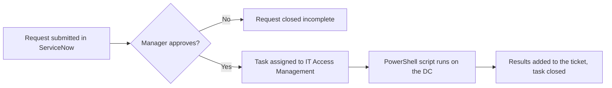

# Access Management Lab (ServiceNow + Active Directory + PowerShell)

I built this lab to practise one of the most common things an IT support team does: giving new employees access and taking it away when they leave, without skipping the approval step or losing track of who did what.

The idea is simple. A request comes in through ServiceNow, the employee's manager approves or rejects it, and an approved request turns into a task for the IT team. The technician then runs a PowerShell script against Active Directory, attaches the output to the ticket and closes it.

Everything runs in my own lab: a Windows Server 2022 VM in VMware Workstation, and a free ServiceNow developer instance (Brazil release).

## How it fits together



## What I set up

**ServiceNow**
- Two catalog items: *New Employee Access Request* and *Employee Offboarding Request*
- A flow in Workflow Studio that sends the request to the requester's manager, creates a catalog task for the *IT Access Management* group if it's approved, and closes the request either way
- Two knowledge articles, one for onboarding and one for offboarding

**Active Directory (Windows Server 2022)**
- New forest `lab.internal`, with a fixed IP and DNS on the DC
- An OU for the lab with `Users`, `Groups` and `Disabled` underneath
- Department groups (`DEPT-IT`, `DEPT-Sales`…) and access groups (`ACCESS-VPN`, `ACCESS-CRM`, `ACCESS-SharedDrive`)

**PowerShell scripts** (in `scripts/`)
- `00-Setup-LabStructure.ps1` creates the OUs and groups. You can run it again safely, since it skips anything that already exists.
- `01-New-UsersFromCsv.ps1` creates users from a CSV, adds them to their groups, sets the manager and forces a password change at first logon. It skips usernames that already exist instead of guessing, because that could be a rehire.
- `02-Disable-UserAccount.ps1` handles offboarding. It refuses admin accounts, saves the user's groups to a backup file, disables the account first, resets the password, removes the groups, moves the account to `Disabled` and then checks its own work.

All three support `-WhatIf`, so I could preview every change before making it. They also write a log, and every account gets the ticket number in its description.

## How I tested it

I didn't just run the happy path. Each test run is logged as a ticket (full list in `docs/ticket-log.md`):

| Test | Ticket | What happened |
|---|---|---|
| Onboarding, approved | RITM0010001 | 4 users created, 1 created with a warning (the `ACCESS-Payroll` group doesn't exist). I raised INC0010001 to follow up |
| Onboarding, rejected | RITM0010003 | Manager rejected it, and the request closed without any account being created |
| Requester with no manager | RITM0010002 | No approver was found, so the request auto-closed. I didn't plan this one (see below) |
| Bad data | RITM0010004 | Duplicate user skipped, row with a missing last name skipped, unknown manager flagged |
| Offboarding | RITM0010005 | Account disabled, groups removed, moved to `Disabled`, all checks passed |
| Offboarding safety | – | Trying to offboard Administrator, an unknown user or an already-disabled user was refused, and nothing changed |

## Things that went wrong (and what I learned)

- **A request closed itself straight away.** I'd submitted it as the admin account by mistake, and admin has no manager in ServiceNow, so the approval step had nobody to send it to. In a real company that means every user needs a manager, or the flow needs a fallback approver group.
- **My offboarding script wouldn't even load.** PowerShell read `$TicketNumber:` inside a string as a drive name. I fixed it by writing `${TicketNumber}:` instead.
- **Wrong ticket number on one account.** I ran the exceptions test before updating the ticket number in the CSV. I corrected the AD description afterwards, and now I always check the ticket number in the `-WhatIf` preview first.
- Smaller stuff: DNS didn't resolve on the new server until I added a second DNS server, and I wasted some time with VirtualBox before switching the lab to VMware.

More detail in `docs/build-log.md`.

## Repo layout

```
scripts/        the three PowerShell scripts
data/           sample CSVs (new hires + a deliberately broken one for testing)
docs/           workflow one-pager, KB articles, ticket log, build log
evidence/logs/  real output from the script runs
screenshots/    ServiceNow and AD screenshots
BUILD-GUIDE.md  step-by-step notes if you want to rebuild it
```

The one-page process document (steps, approvals and exceptions) is in `docs/workflow-one-pager.md`.

## What's next

- [ ] Microsoft Forms + Power Automate version of the approval flow (needs an M365 tenant)
- [ ] Set the request's Stage field properly when it's rejected
- [ ] A small script to undo an offboarding from the groups backup file

---

This is a lab with made-up users and a test domain, so there's no real data anywhere in it.

Meetkumar Patel
