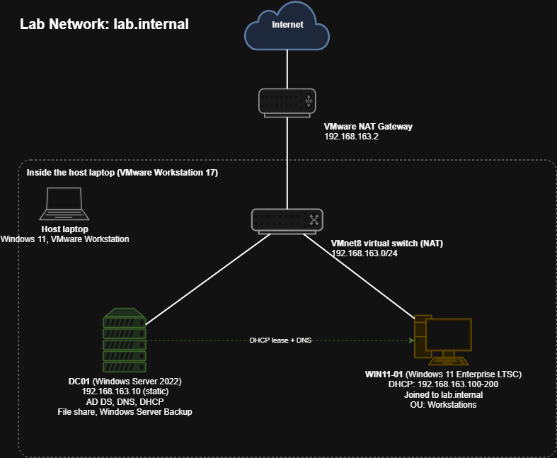
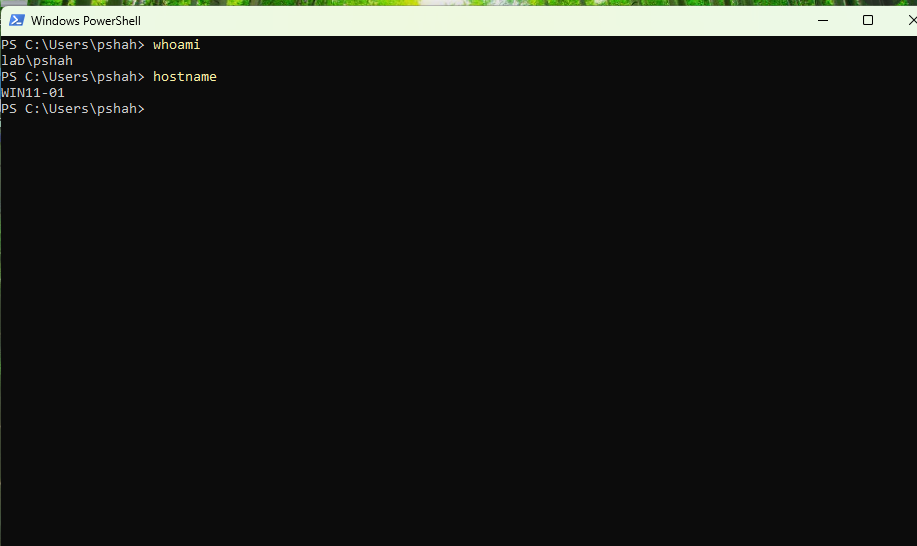
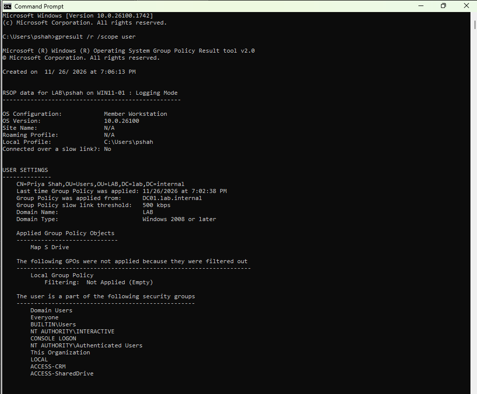
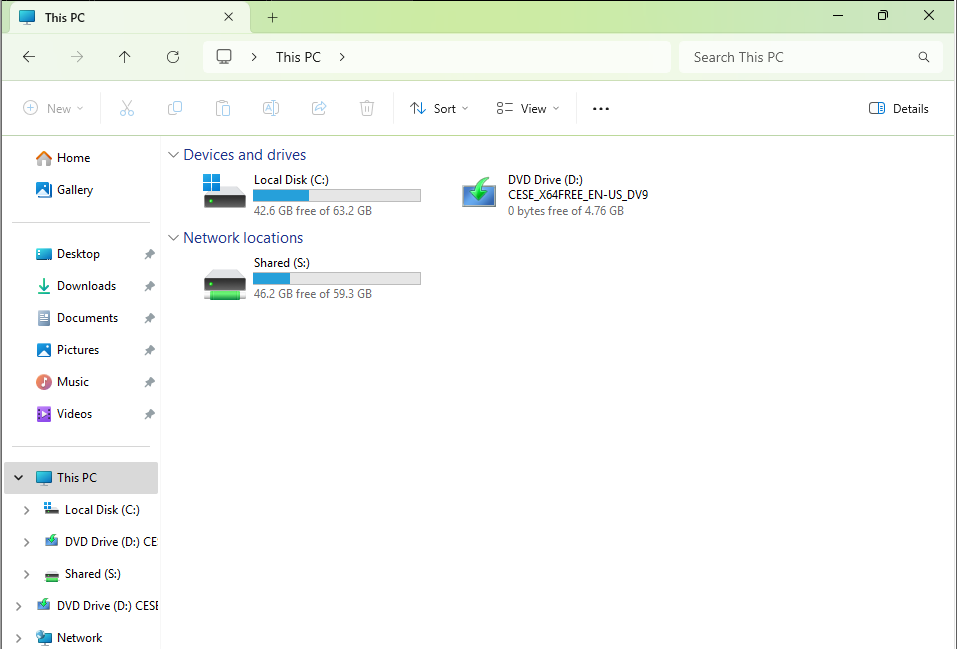
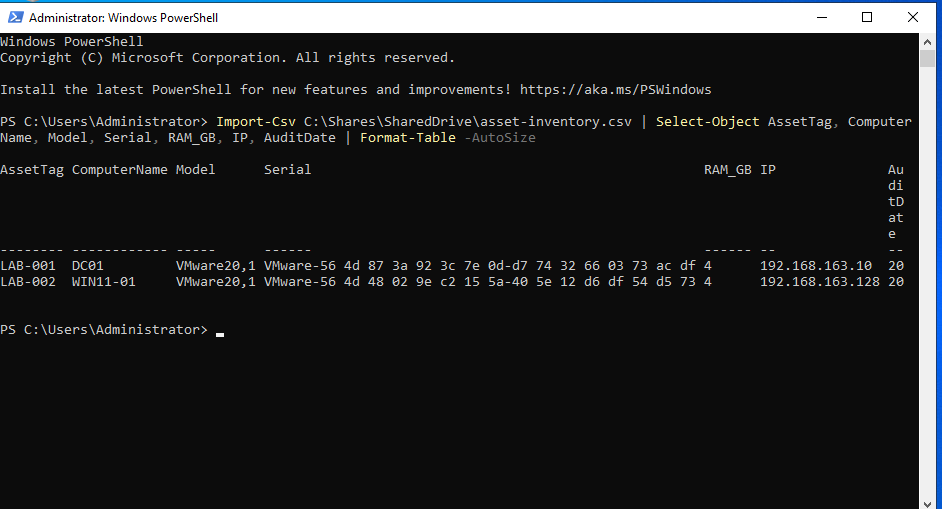

# Windows Endpoint & Group Policy Lab

Part 2 of my home lab. In the [Access Management Lab](../access-management-lab/) I set up a domain controller and scripted onboarding/offboarding. That covered accounts, but there was no actual PC in the domain yet. So this time I added a Windows 11 workstation and set up the stuff a small IT team deals with every day: DHCP, Group Policy, a shared drive, backups, a password manager, an asset list and a network diagram.

Honestly, I picked these topics by going through an IT Analyst job posting and writing down everything I couldn't show yet. Then I built it.

Meetkumar Patel, November 2026

## The setup



| Machine | What it does | IP |
|---|---|---|
| DC01 (Windows Server 2022) | Domain controller for lab.internal. Also runs DNS, DHCP, the file share and backups | 192.168.163.10 (static) |
| WIN11-01 (Windows 11 Enterprise LTSC) | Workstation joined to the domain | Gets one from DHCP (.100 to .200) |
| VMware NAT gateway | Gets the lab out to the internet | 192.168.163.2 |

All of it runs in VMware Workstation 17 on my laptop.

## What I did

### DHCP on the server

VMware hands out IPs on its NAT network by default. I switched that off and installed the DHCP role on DC01 so the server is in charge of addressing, like it would be in an office.

- Scope "LAB-Clients": 192.168.163.100 to .200
- Gateway .2, DNS .10, domain name lab.internal
- Authorized the DHCP server in AD

When WIN11-01 booted it got 192.168.163.128 from DC01, with DC01 as DNS. That was the first sign things were working.


### Windows 11 workstation

- Installed Windows 11 Enterprise LTSC (the free evaluation) in a new VM
- Joined it to lab.internal with `Add-Computer` and renamed it WIN11-01
- Made a Workstations OU and moved the PC into it, so I could target computer policies at workstations only
- Logged in as Priya Shah, one of the users my onboarding script created in part 1



### Group Policy

I made three GPOs:

| GPO | Linked to | What it does |
|---|---|---|
| Default Domain Policy | lab.internal | Passwords need 12+ characters, account locks after 5 wrong tries |
| Map S Drive | Users OU | Maps `\\DC01\SharedDrive` as S:, but only for people in ACCESS-SharedDrive |
| Workstation Security | Workstations OU | Screen locks after 10 minutes idle, and an "Authorized Use Only" message shows before login |

For the drive map I used item-level targeting, so the drive only shows up for members of the group. The share and NTFS permissions also only give Modify to that group. Access comes from groups, not from adding people one by one.

I checked everything on the workstation with `gpresult /r`:





### Backup, and actually testing the restore

- Added a second virtual disk to DC01 (E:) just for backups
- Backed up the shared folder with Windows Server Backup (`wbadmin`)
- Deleted a file on purpose and restored it from the backup

The restore was the part I cared about. You don't really know a backup works until you've pulled something back out of it.


### Password manager with MFA

I'd been keeping lab passwords in a notepad file, which is a bad habit. I moved them all into Bitwarden (domain admin, local admin, test user, ServiceNow instance, VMware encryption password), turned on two-step login with an authenticator app, and wrote the recovery code on paper. Then I deleted the notepad file.

### Asset inventory

I wrote a few lines of PowerShell that pull the manufacturer, model, serial number, OS, RAM and IP from a machine and add a row to a CSV on the shared drive. I ran it on both machines. It's simple, but it means the inventory comes from the machine itself, not from someone typing serial numbers by hand.



```powershell
$cs = Get-CimInstance Win32_ComputerSystem; $bios = Get-CimInstance Win32_BIOS; $os = Get-CimInstance Win32_OperatingSystem
[pscustomobject]@{ AssetTag='LAB-002'; ComputerName=$env:COMPUTERNAME; Model=$cs.Model; Serial=$bios.SerialNumber; OS=$os.Caption; RAM_GB=[math]::Round($cs.TotalPhysicalMemory/1GB) } |
  Export-Csv \\DC01\SharedDrive\asset-inventory.csv -Append -NoTypeInformation
```

### Network diagram

Drew the lab in draw.io. The editable file is [network-diagram.drawio](network-diagram.drawio), so I can update it when I add more machines.

## Things that went wrong

Plenty went wrong. These were the main ones:

| What happened | Why | How I fixed it |
|---|---|---|
| Windows 11 setup kept pushing me to sign in with a Microsoft account | I'd downloaded the normal Windows 11 ISO, and it installed **Home**. Home can't join a domain at all | Checked with `winver`, deleted the VM, reinstalled from the Enterprise evaluation |
| `Install-WindowsFeature` and `Get-ADOrganizationalUnit` came back "not recognized" | I was typing into PowerShell on the wrong machine (laptop or workstation, not the server) | Now I run `hostname` first before any server command |
| Domain join said "user name or password is incorrect" | Wrong password the first time, then a stray `\` got pasted onto the end of the command | Used `administrator@lab.internal` as the username and retyped the command |
| The S: drive didn't show up for Priya | `gpresult /r` showed the GPO was applying, but she wasn't in ACCESS-SharedDrive, so the targeting filtered the drive out | Added her to the group, signed out and back in |
| Restore failed with "specified backup was not found" | I used an example version ID, not my own. wbadmin also shows the ID in UTC, so it looked like tomorrow's date and confused me | Copied the real ID from `wbadmin get versions` |
| Inventory script got "Access denied" saving to C:\ | Normal users can't write to the root of C:. That's the security doing its job | Saved to the network share instead |
| Running cmd as admin with LAB\labadmin failed | labadmin is a **local** account. The "Domain join instead" option in Windows setup makes a local account, not a domain one | Used LAB\Administrator to elevate |

The `gpresult` one taught me the most. Before, I would have just assumed the GPO was broken. Reading the output showed the GPO was fine and the problem was group membership.

## How I used AI tools

I used Claude like a senior coworker I could ask questions at any time. I didn't use it to do the lab for me. It helped in a few different ways:

| How | Example from this lab |
|---|---|
| **Planning** | I gave it the IT Analyst job posting and my current lab, and we worked out which skills were missing. That list became this project. |
| **Learning new things fast** | I asked it to explain things I hadn't used before, like DHCP scope options, item-level targeting in Group Policy, and the difference between Windows 11 Enterprise and Enterprise LTSC. |
| **Reading error messages** | When `Install-WindowsFeature` came back "not recognized", it pointed out that the command only exists on Windows Server, which told me I was on the wrong machine. |
| **Troubleshooting with evidence** | For the missing S: drive, I shared my `gpresult /r` output. Reading it together showed the GPO was applying but the user wasn't in the targeting group. |
| **Checking commands before running them** | Before running anything on the domain controller, I went through what each part of the command does, for example what `-recoveryTarget` and `-overwrite` mean in `wbadmin`. |
| **Writing it up** | It helped me organize my notes into this README. I edited it so it says what actually happened. |

What I always did myself: ran every step in the lab, checked the result (`ipconfig`, `gpresult`, `whoami`, the restored file), and took the screenshots. When something didn't work, I went back with the actual error, not a guess. That's how I'd use approved AI tools at work: to learn and troubleshoot faster, then verify everything before calling it fixed.

## Skills used

Windows 11 deployment, domain join, DHCP, OUs, Group Policy (security settings, drive maps, item-level targeting), share and NTFS permissions, Windows Server Backup and restores, password management, MFA, PowerShell, asset inventory, network documentation, troubleshooting with gpresult, ipconfig and hostname.
