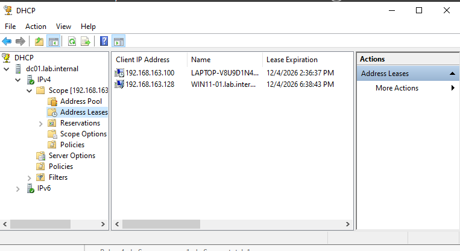
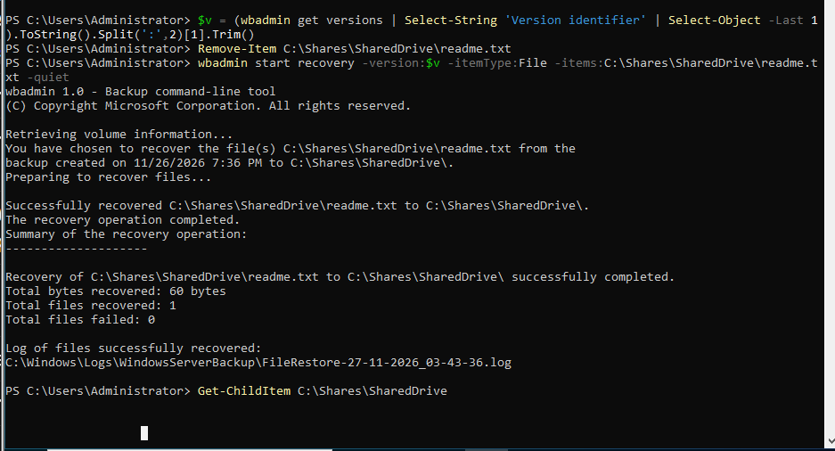

# Windows Endpoint & Group Policy Lab

This is part 2 of my home lab. In the [Access Management Lab](../access-management-lab/) I built a domain controller and automated onboarding and offboarding. Here I added an actual workstation to that domain and set up the everyday things an IT team looks after: DHCP, Group Policy, a shared drive, backups, password management with MFA, an asset inventory and a network diagram.

I built it after reading an IT Analyst job posting and listing the skills I couldn't show yet. Then I went and built them.

**Built by:** Meetkumar Patel, November 2026

## What's in the lab


| Machine | Role | IP |
|---|---|---|
| DC01 (Windows Server 2022) | Domain controller for lab.internal: AD DS, DNS, DHCP, file share, Windows Server Backup | 192.168.163.10 (static) |
| WIN11-01 (Windows 11 Enterprise LTSC) | Domain-joined workstation in the Workstations OU | DHCP, 192.168.163.100-200 |
| VMware NAT gateway | Internet access for the lab | 192.168.163.2 |

Everything runs in VMware Workstation 17 on my laptop.

## What I did

### 1. Moved DHCP to the domain controller

VMware's NAT network hands out IPs by default. I turned that off and set up the DHCP role on DC01 instead, so the server controls addressing the same way it would in an office.

- Scope **LAB-Clients**: 192.168.163.100-200, gateway .2, DNS .10, domain lab.internal
- Authorized the DHCP server in Active Directory

WIN11-01 picked up 192.168.163.128 from DC01 on first boot, with DC01 as its DNS server.



### 2. Built a Windows 11 workstation and joined it to the domain

- Installed Windows 11 Enterprise LTSC (evaluation) in a new VM
- Joined it to lab.internal with `Add-Computer` and renamed it WIN11-01
- Created a **Workstations** OU and moved the computer into it, so computer policies can target workstations only
- Logged in as a domain user (Priya Shah, created by my onboarding script in part 1)


### 3. Group Policy

| GPO | Linked to | What it does |
|---|---|---|
| Default Domain Policy | lab.internal | Minimum password length 12, account locks after 5 failed attempts |
| Map S Drive | Users OU | Maps `\\DC01\SharedDrive` as S:, **only** for members of ACCESS-SharedDrive (item-level targeting) |
| Workstation Security | Workstations OU | Locks the screen after 10 minutes idle, shows an "Authorized Use Only" banner before login |

The shared folder gives Modify rights to ACCESS-SharedDrive only, on both the share and the NTFS permissions. Access comes from group membership, never from individual users.

Checked with `gpresult /r` on the workstation:


### 4. Backup and a tested restore

- Added a second virtual disk to DC01 as the backup target (E:)
- Backed up the shared drive with Windows Server Backup (`wbadmin`)
- Deleted a file on purpose, then restored it from the backup

A backup you've never restored from is just a hope, so the restore was the real test.



### 5. Password manager with MFA

Moved all lab credentials (domain admin, local admin, test user, ServiceNow instance, VMware encryption key) out of a notepad file and into **Bitwarden**, protected by a master password and an authenticator app for two-step login. Recovery code stored offline.

### 6. IT asset inventory

Wrote a short PowerShell snippet that reads each machine's manufacturer, model, serial number, OS, RAM and IP through CIM and appends a row to a shared CSV on the S: drive. I ran it on both machines to get a simple, repeatable inventory.


```powershell
$cs = Get-CimInstance Win32_ComputerSystem; $bios = Get-CimInstance Win32_BIOS; $os = Get-CimInstance Win32_OperatingSystem
[pscustomobject]@{ AssetTag='LAB-002'; ComputerName=$env:COMPUTERNAME; Model=$cs.Model; Serial=$bios.SerialNumber; OS=$os.Caption; RAM_GB=[math]::Round($cs.TotalPhysicalMemory/1GB) } |
  Export-Csv \\DC01\SharedDrive\asset-inventory.csv -Append -NoTypeInformation
```

### 7. Network diagram

Drew the lab in draw.io. The source file is [network-diagram.drawio](network-diagram.drawio) so it can be updated when the lab changes.

## Things that went wrong (and what I learned)

| Problem | Cause | Fix |
|---|---|---|
| Windows 11 kept forcing a Microsoft account sign-in | I had downloaded the normal Windows 11 ISO, which installed **Home**. Home can't join a domain at all | Checked the edition with `winver`, deleted the VM and reinstalled from the Enterprise evaluation ISO |
| `Install-WindowsFeature` and `Get-ADOrganizationalUnit` "not recognized" | I was typing in PowerShell on the wrong machine (my laptop or the workstation) | Now I run `hostname` before any server command |
| Domain join failed with "user name or password is incorrect" | Wrong credentials, then a stray `\` pasted at the end of the command | Used `administrator@lab.internal` as the username and retyped the command cleanly |
| S: drive didn't appear for the test user | `gpresult /r` showed the GPO applying, but the user wasn't in ACCESS-SharedDrive, so item-level targeting filtered the drive out | Added her to the group, signed out and back in |
| Restore said "specified backup was not found" | I used an example version ID, not my own. wbadmin shows version IDs in UTC, so it looked like tomorrow's date | Used the real ID from `wbadmin get versions` |
| Inventory script got "Access denied" on C:\ | Standard users can't write to the root of C: (that's the security working) | Saved to the network share instead |
| Running elevated cmd as LAB\labadmin failed | labadmin is a **local** account. The "Domain join instead" option in Windows setup creates a local account, not a domain one | Used LAB\Administrator for elevation |

## How I used AI tools

I used Claude as a study partner and troubleshooting helper throughout: to plan the build, explain errors, and check commands before running them. For example, when the S: drive didn't show up, I pasted the `gpresult /r` output and worked out together that the user was missing from the targeting group. I verified every fix in the lab before moving on.

## Skills shown

Windows 11 deployment, domain join, DHCP server setup, OUs, Group Policy (security settings, drive maps, item-level targeting), share and NTFS permissions, Windows Server Backup and restore testing, password management, MFA, PowerShell/CIM inventory, network documentation, troubleshooting with gpresult, ipconfig and hostname.
